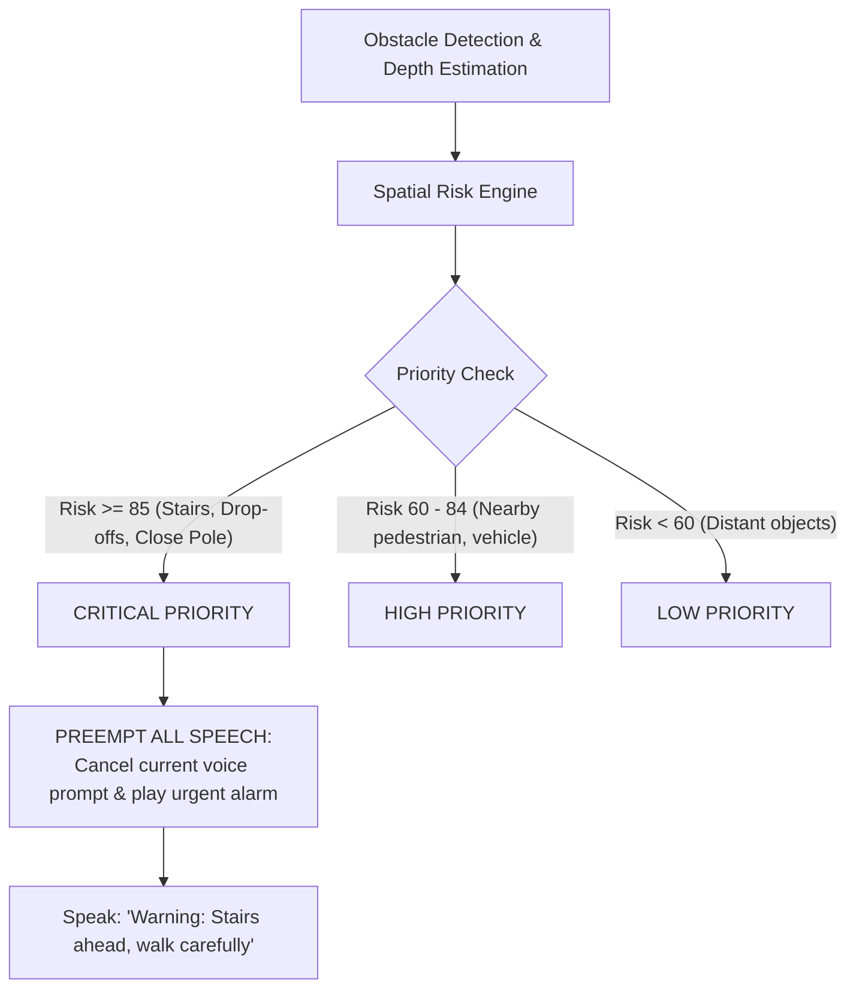

# Drishti Saathi | दृष्टि साथी
### Offline, Privacy-First AI Voice Assistant for the Visually Impaired

> **"Your AI Companion for Independent, Safe Navigation"**  
> *100% On-Device Processing • Zero Cloud Latency • Permissive Open-Source AI*

---

## 🚀 Overview

**Drishti Saathi** is an edge-native, privacy-preserving Progressive Web App (PWA) designed to empower blind and visually impaired individuals with real-time, directional obstacle detection and hands-free voice control.

While white canes only detect hazards in immediate physical contact, Drishti Saathi looks ahead using the phone camera, estimates obstacle proximity and direction, and warns the user through natural spoken Hindi and English with zero internet dependency.

---

## 🎙️ Full Voice Control System

Drishti Saathi features an end-to-end, multi-lingual **Voice Control & Auditory Feedback Architecture** designed specifically for non-visual operation:

### 1. Hands-Free & Gesture Activation
- **Touch-Anywhere Push-To-Talk**: The entire screen serves as a single tactile target. Users can tap anywhere to issue voice instructions without needing to locate buttons.
- **Continuous Background Listening**: Automatically listens for wake-phrases while walking.
- **Mic Ducking & Echo Cancellation**: Prevents feedback loops by automatically suppressing speech recognition while the phone’s TTS voice is speaking.

### 2. Supported Voice Commands (Bilingual)

| User Intent | English Command Examples | Hindi Commands (हिंदी) | Hinglish Transliterations |
| :--- | :--- | :--- | :--- |
| **Scene Description** | *"What's in front of me?"*, *"Describe scene"*, *"Look around"* | *"सामने क्या है?"*, *"क्या दिख रहा है?"*, *"दृश्य बताओ"* | `samne kya hai`, `kya dikh raha hai` |
| **Navigation Start** | *"Start navigation"*, *"Begin walking"* | *"नेविगेशन शुरू करो"*, *"चालू करो"* | `navigation shuru karo`, `start karo` |
| **Navigation Stop** | *"Stop navigation"*, *"Turn off"* | *"नेविगेशन बंद करो"*, *"रोको"* | `navigation band karo`, `roko` |
| **Pause / Resume** | *"Pause"*, *"Wait a moment"*, *"Resume"* | *"रुको"*, *"ठहरो"*, *"आगे बढ़ो"* | `ruko`, `continue karo` |
| **Path Clearance** | *"Is path clear?"*, *"Any obstacles ahead?"* | *"क्या रास्ता साफ है?"*, *"कोई रुकावट है?"* | `kya rasta saaf hai`, `koi rukawat` |
| **Repeat Alert** | *"Say that again"*, *"Repeat last alert"* | *"फिर से बोलो"*, *"दोहराओ"* | `phir se bolo`, `dobara bolo` |
| **Language Switch** | *"Speak Hindi"*, *"Switch to English"* | *"हिंदी में बोलो"*, *"अंग्रेजी में बोलो"* | `hindi me bolo`, `english me bolo` |
| **Speech Speed** | *"Speak faster"*, *"Speak slower"* | *"तेज़ बोलो"*, *"धीमे बोलो"* | `tez bolo`, `dheeme bolo` |
| **Mute / Unmute** | *"Mute alerts"*, *"Unmute"* | *"शांत रहो"*, *"आवाज चालू"* | `shant raho`, `aawaz chalu` |
| **Battery Status** | *"Battery status"*, *"Check battery"* | *"बैटरी कितनी है?"*, *"चार्जिंग बताओ"* | `battery kitni hai` |
| **Help & Tutorial** | *"Help"*, *"What can I say?"* | *"मदद"*, *"कमांड बताओ"* | `madad karo`, `commands batao` |

---

## 🔔 Synthetic Earcon Audio Cues

For instant feedback without cognitive overload, Drishti Saathi synthesizes instantaneous earcons using the **Web Audio API** (zero downloaded audio files required):

- **Listen Start (Rising Chime)**: $440\text{Hz} \to 660\text{Hz}$ tone confirms microphone is capturing speech.
- **Command Acknowledged (Bright Ping)**: $587\text{Hz} \to 880\text{Hz}$ indicates intent was matched.
- **Critical Hazard Alarm**: High-frequency dual emergency pulse ($1046\text{Hz} \to 1318\text{Hz}$) paired with continuous haptic vibration.
- **Clear Path (Soft Melody)**: Gentle two-tone chord signaling unobstructed path.

---

## ⚡ Safety Decision & Priority Preemption



---

## 🔒 Privacy & Zero-Data-Egress Guarantee

1. **No Cloud Ingestion**: Camera frames are processed strictly in device memory via WebGL/WebGPU and Canvas buffers.
2. **Immediate Garbage Collection**: Image buffers are instantly purged after inference; no frames are saved to disk, `localStorage`, or IndexedDB.
3. **No Network Telemetry**: Zero analytics SDKs, external APIs, or tracking cookies.

---

## 🛠️ Quickstart

### Prerequisites
- Node.js 18+
- Modern browser supporting Web Speech API & WebGPU/WebGL (Chrome, Edge, Safari)

### 1. Installation
```bash
git clone https://github.com/your-username/drishti-saathi.git
cd drishti-saathi
npm install
```

### 2. Download Open-Source ONNX Weights
```bash
# Windows
./models/download_models.ps1

# Linux / Mac
./models/download_models.sh
```

### 3. Run Development Server
```bash
npm run dev
```

### 4. Run Test Suite
```bash
npm test
```

---

## ⚠️ Assistive Disclaimer
*Drishti Saathi is an assistive prototype designed to supplement, not replace, traditional mobility aids (such as white canes or trained guide dogs). Always use a physical cane in unfamiliar or high-traffic environments.*
